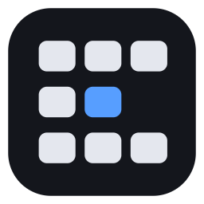

<a href="README.md">English</a> · <a href="README.ko.md">한국어</a> · <a href="README.zh.md">中文</a>

<strong><a href="https://github.com/philaxis/flick/releases/latest/download/Flick.exe">⬇ Windows용 Flick 받기</a></strong>

버튼을 누른 채 마우스를 밀면 옆 데스크톱입니다.

<a href="https://philaxis.github.io/flick/">Flick 웹사이트에서 동작 보기</a>

---

**데스크톱이 격자가 됩니다.** 셸프(행) 하나에 같은 작업의 데스크톱을 모읍니다. 위아래는 다른 셸프입니다. 이름은 셸프에만 붙습니다.

**누른 채 밀기.** 트리거를 누르고 마우스를 밀면 그 방향으로 한 칸 넘어갑니다. 커서는 제자리에 있습니다.

**눌렀다 떼면 전체 보기.** 지금 칸의 창들과 작은 지도가 뜹니다. 창을 지도의 칸으로 끌면 옮겨집니다.

**버튼은 마음대로.** 처음에는 마우스 "앞으로" 버튼입니다. 트레이 아이콘 클릭 → 설정 → *변경*을 누른 뒤 원하는 버튼이나 키 여러 개를 누르면 그걸로 바뀝니다.

**작고 무료.** 1MB도 안 되는 실행 파일 하나. 가입도 설치 화면도 없습니다. 오픈 소스(MIT).

**세 손가락 터치패드.** 설정이나 첫 설정 마법사에서 켭니다. Windows가 아직 세 손가락을 쓰고 있으면 Windows 터치패드 설정의 *세 손가락 제스처*에서 *살짝 밀기*와 *탭*을 *없음*으로 바꾸세요. Flick이 상태와 함께 그 설정을 여는 버튼을 보여 줍니다. 탭하면 전체보기가 열립니다. 누른 채 축 데드존을 지나 기본 12mm 움직이면 한 칸을 넘깁니다. 양축의 기본 거리는 같습니다. 터치패드는 스크롤처럼 손가락과 반대로, 마우스는 손 방향으로 이동합니다.

**마우스와 터치패드를 따로.** 방향별 *넘어가는 데 필요한 거리*는 config.toml의 `[mouse]`·`[touchpad]`에 있는 `step_x`·`step_y`로 정합니다. Distance 전체가 한 칸을 확정하는 문턱입니다. 기본값은 마우스 좌우·위아래 모두 220 counts, 터치패드 양축 모두 12mm이며, 값을 키울수록 더 움직여야 넘어갑니다. 마우스 실제 거리는 DPI에 따라 달라집니다. config 버전 3은 옛 거리 값을 한 번만 새 기본값으로 이전하고, 그 뒤 사용자가 바꾼 값은 유지합니다. 예전 `notch_x/y` 값은 호환용으로 읽지만 F 곡선에는 영향을 주지 않습니다.

**화면이 손을 따라옵니다.** `follow_x` / `follow_y`가 켜져 있으면(장치·방향별 기본값, config.toml) F 방식으로 최대 20%만 탄성 있게 당겨지다가 설정한 거리 전체를 움직인 순간 다음 칸을 확정합니다. 그림은 그 칸으로 스프링 이동하고 도착할 때 살짝 튕깁니다. 손을 놓으면 플링 예측 없이 확정 칸에 정착하며 Windows 데스크톱은 한 번만 전환합니다. 행을 확정하면 축 잠금을 풀어 같은 홀드 안에서 바로 좌우로 움직일 수 있습니다. 고정 창의 동작은 유지됩니다. 끄면 같은 Distance 문턱에서 Windows를 즉시 전환하며, 마우스의 손 따라가기는 키보드 전환 애니메이션에도 적용됩니다.

**화면이 곧 지도입니다.** 움직이는 동안 화면이 70%까지 물러나 어두운 이웃 칸을 보여 주고, 멈추면 원래 크기로 다가옵니다. 셸프 이름은 위쪽 가운데에 표시됩니다. 좌우로는 해당 셸프만 움직이며 전체보기와 미니맵도 같은 스프링 곡선을 씁니다. 미니맵은 기본 꺼짐이며 config.toml에서 `minimap = true`로 켭니다.

**놓는 자리가 고정을 정합니다.** 보드에서 창 미리보기를 아래 지도로 끌어 놓으세요. 지도 위의 가는 레일에 놓으면 모든 셸프에, 셸프 이름 옆에 놓으면 그 셸프에 고정되고, 셀에 놓으면 고정이 풀리고 그 셀의 창이 됩니다. 고정된 창은 위 미리보기에는 나오지 않고 지도의 그 자리에 작은 창으로 보이며, 미리보기처럼 눌러 가거나 끌어 옮깁니다. 위 미리보기에 놓으면 고정이 풀리고 선택한 셀의 창이 됩니다. 고정할 때마다 *항상 위*가 켜지며, 끄는 것은 창의 *항상 위* 버튼입니다. 고정 메뉴(`Ctrl+Alt+Win+P`)도 같은 상태를 쓰며, 체크된 항목을 다시 선택하면 꺼집니다. *앱:* 표시는 앱 전체에서 상속된 고정이며 고정 메뉴의 앱 항목에서만 바꿉니다. 창 하나의 버튼이 같은 앱의 다른 창까지 해제하지 않습니다.

**키보드로 설정하기.** Tab / Shift+Tab으로 보이는 포커스를 옮기고, 방향키로 슬라이더를 조절하고, Space / Enter로 버튼이나 토글을 실행합니다. 설정은 한 페이지이며 트리거(변경), Windows와 함께 시작, 관리자 권한 실행, 세 손가락 터치패드, 넘김 인정 시간이 있습니다. 거리와 나머지 설정은 config.toml에 있습니다. 창은 모니터 작업 영역 안으로 제한되며 필요하면 휠·스크롤바·Page Up / Page Down으로 세로 스크롤합니다. 포커스도 자동으로 보이는 곳으로 이동합니다. 설정과 설정 마법사는 Windows 표시 언어(한국어·중국어, 그 외 영어)를 따르며 설정 마법사에는 현재 트리거 이름이 나옵니다.

**조용한 시작.** 관리자 권한은 설정의 *관리자 권한 실행*에서 직접 켭니다. 거절하거나 나중으로 미뤄도 다음 시작에 UAC를 다시 요청하지 않습니다. 트레이 위치 풍선 알림은 첫 설정을 마칠 때만 뜹니다. 전체 보기 지도의 칸은 커서가 잠깐 머물면 그 칸의 창을 보여 주므로, 지도 위를 지나가도 걸리지 않습니다. 쓰이지 않던 `dwell_ms`는 무시하므로 기존 config.toml에서 지워도 됩니다.

## 시작하기

1. 위 버튼으로 받아 실행합니다. 스스로 설치하고 윈도우와 함께 시작합니다.
2. Windows가 **Windows의 PC 보호**라고 하면 **추가 정보**, **실행**을 차례로 누릅니다. 실행 파일에 코드 서명이 없기 때문입니다.
3. 설정 마법사가 열리면 쓸 버튼을 누르고, 정밀 터치패드가 있으면 세 손가락을 켜고, 필요하면 데스크톱을 만듭니다.
4. 직접 넘겨 본 뒤 시계 옆의 트레이 아이콘을 찾습니다. 누르면 설정, 오른쪽 클릭하면 메뉴가 열립니다.

## 반응이 없을 때

- 옆 버튼이 없나요? 휠 버튼이나 키, 세 손가락을 쓰세요.
- Logitech Options+, G HUB, Razer Synapse 같은 마우스 소프트웨어가 옆 버튼을 가져갔나요? 뒤로/앞으로로 되돌리거나, 키 조합을 보내게 하고 설정 마법사에서 **키 사용…**으로 그 조합을 고르세요.
- 데스크톱이 하나뿐인가요? 설정 마법사에서 만들거나 전체보기의 **+**로 만드세요.
- 관리자 권한으로 실행한 창이 앞에 있나요? Flick은 그 위에서는 버튼을 듣지 못합니다. 다른 창을 누르거나 설정에서 **관리자 권한 실행**을 켜세요.
- Windows 10이거나 오래된 Windows 11 빌드인가요? 지원하지 않습니다. Flick이 그렇게 알리고 종료합니다.
- 그 밖의 문제는 로그 `%APPDATA%\Flick\log.txt`를 보세요.

## 알아 둘 것

- 윈도우 11 23H2(빌드 22631.3085 이상), 24H2(빌드 26100.2605 이상), 25H2에서 동작합니다. 그 밖의 버전에서는 안내만 띄우고 실행하지 않습니다.
- 제거: 설정 → 앱 → 설치된 앱 → Flick.

## 빌드

윈도우에서 `cargo build --release`, WSL에서는 `scripts/build-wsl.sh build --release`.

[MIT](LICENSE). `vendor/winvd`와 `vendor/winvd-24h2`는 [VirtualDesktopAccessor](https://github.com/Ciantic/VirtualDesktopAccessor)(MIT)에서 가져왔습니다.
