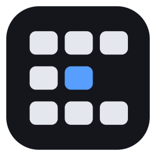

<a href="README.md">English</a> · <a href="README.ko.md">한국어</a> · <a href="README.zh.md">中文</a>

<strong><a href="https://github.com/philaxis/flick/releases/latest/download/Flick.exe">⬇ Download Flick for Windows</a></strong>

Hold a button, flick the mouse, and you are on the next desktop.

<a href="https://philaxis.github.io/flick/">See how it works on the Flick website</a>

---

**Your desktops become a grid.** A shelf (row) holds the desktops for one job; up and down leads to other shelves. Only shelves have names.

**Hold and flick.** Hold the trigger, push the mouse, and you move one desktop that way. The pointer stays where it was.

**Tap to see everything.** Tap the trigger for the windows on this desktop and a small map of all of them. Drag a window onto the map to move it.

**Double-tap to go back.** Tap the trigger twice quickly to jump back to the desktop you were on before your last move, however many desktops that move went past. Double-tap again to return.

**Any button you like.** It starts as the mouse "forward" button. Click the tray icon for Settings → *Change* and press whatever you want instead, even several keys at once.

**Small and free.** One exe under 1 MB. No account, no installer to click through. Open source, MIT.

**Three-finger touchpad.** Turn it on in Settings, or in the setup window on first run. If Windows still uses three fingers itself, set *Swipes* and *Taps* to *Nothing* under *Three-finger gestures* in Windows touchpad settings; Flick shows the status and a button to open those settings. Tap for the board, or hold and move to switch cells. The default movement distance is 12 mm on either axis, after the axis dead zone. By default the desktops go against the fingers, like scrolling; the mouse follows the hand.

**Mouse and touchpad each their own way.** Each device sets its own *Distance to switch* for each axis in config.toml (`step_x` and `step_y` under `[mouse]` and `[touchpad]`). The full Distance is the movement needed to commit one cell: 220 raw mouse counts on both axes (physical travel depends on DPI), or 12 mm on both touchpad axes by default. Larger values need more movement. Config version 3 resets older distance values to these defaults once; later changes are preserved. Legacy `notch_x/y` values remain readable but do not change F motion.

**The screen follows the hand.** With `follow_x` / `follow_y` on (the default per device and axis in config.toml), variant F gives a short elastic pull of at most 20%, then commits the next cell when the hand travels the full configured Distance. The picture springs into that cell with a slight arrival bounce; releasing settles on the committed cell without fling prediction, and Windows switches once. Committing a shelf frees the axis for the next movement in the same hold. Pinned windows keep their existing behavior. Turning follow off switches Windows immediately at the same full Distance; Mouse follow also controls keyboard shortcut animations. Settings are stored under `[mouse]` and `[touchpad]` in config.toml.

**The screen shows where you are.** During motion the screen recedes to 70%, revealing darker neighbors, then returns to full size; the shelf name stays above it. Moving sideways slides only that shelf. The board and optional minimap use the same spring curve. The minimap is off by default; set `minimap = true` in config.toml.

**Where you drop a window pins it.** On the board, drag a window's preview down to the map: onto the thin rail above it to show the window on all shelves, beside a shelf's name to pin it to that shelf, or onto a cell to make it that cell's own window again, unpinned. A pinned window is not shown among the previews but small in its place on the map, where it is clicked or dragged like a preview; dropped on the previews, it is unpinned into the selected cell. Pinning puts it on top each time; its *On top* button takes it down. The pin menu (`Ctrl+Alt+Win+P`) offers the same choices; select a checked choice to turn it off. An *App:* pin is inherited by every window of that app and can only be changed through the menu’s App choices; clicking a window never unpins its whole app.

**Settings with the keyboard.** Tab / Shift+Tab move the visible focus, arrow keys adjust a focused slider, and Space / Enter activate a button or toggle. Settings has one page: Trigger (Change), Start with Windows, Run as administrator, Three-finger touchpad and Flick time; distances and the rest are in config.toml. The window fits the monitor’s work area and scrolls vertically when needed, with the wheel, scrollbar or Page Up / Page Down; keyboard focus scrolls into view. Settings and the setup window use the Windows UI language (Korean, Chinese, or English otherwise), and the setup window names the current trigger.

**Startup stays quiet.** Elevation is opt-in through *Run as administrator* in Settings, so declining or postponing it never triggers another UAC request on startup. The tray-location balloon appears only when the first setup is completed. A cell of the board's map shows its windows once the cursor rests on it a moment, so passing over the map does not stick; the obsolete `dwell_ms` key is ignored and can be removed from older config files.

## Get started

1. Download with the button above and run it. It installs itself and starts with Windows.
2. If Windows says **Windows protected your PC**, click **More info**, then **Run anyway**. The exe is not code-signed.
3. The setup window opens: press the button you want to hold, turn on three fingers if your PC has a precision touchpad, and make desktops if you need them.
4. Try a flick, then find the tray icon by the clock. Click it for Settings, or right-click it for the menu.

## If nothing happens

- No side buttons? Use the wheel button, a key, or three fingers.
- Mouse software (Logitech Options+, G HUB, Razer Synapse) took over the side buttons? Set them back to Back/Forward, or send a key combination and choose it with **Use a key…** in the setup window.
- Only one desktop? Make some in the setup window, or with **+** in the overview.
- A window run as administrator is in front? Flick can't hear the button over it; click another window, or turn on **Run as administrator** in Settings.
- Windows 10 or an older Windows 11 build? Not supported; Flick says so and exits.
- Anything else? The log is at `%APPDATA%\Flick\log.txt`.

## Good to know

- For Windows 11 23H2 (build 22631.3085 or later), 24H2 (build 26100.2605 or later) and 25H2. On any other version it tells you so and does not start.
- To remove it: Settings → Apps → Installed apps → Flick.

## Build

`cargo build --release` on Windows, or `scripts/build-wsl.sh build --release` from WSL.

[MIT](LICENSE). `vendor/winvd` and `vendor/winvd-24h2` come from [VirtualDesktopAccessor](https://github.com/Ciantic/VirtualDesktopAccessor) (MIT).
