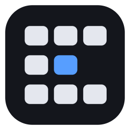

<a href="README.md">English</a> · <a href="README.ko.md">한국어</a> · <a href="README.zh.md">中文</a>

<strong><a href="https://github.com/philaxis/flick/releases/latest/download/Flick.exe">⬇ 下载 Windows 版 Flick</a></strong>

按住按键,轻推鼠标,就到了旁边的桌面。

<a href="https://philaxis.github.io/flick/">在 Flick 网站上看它怎么用</a>

---

**桌面变成网格。** 一个架子（行）放同一项工作的桌面，上下切换其他架子。只有架子可以命名。

**按住再推。** 按住触发键,把鼠标往一个方向推,就往那边移动一格。指针留在原地。

**轻点看全部。** 轻点触发键,会显示当前桌面的窗口和一张小地图。把窗口拖到地图的格子上就能移过去。

**按键随你定。** 默认是鼠标的“前进”侧键。点击托盘图标打开设置 → *更改*,按下你想用的按键即可,也可以同时按几个键。

**小巧免费。** 一个不到 1 MB 的 exe。不用注册,没有安装向导。开源,MIT 许可。

**三指触摸板。** 将 Windows 三指滑动和点击设为“无”后，在 Flick 设置中启用。轻点打开总览，按住移动切换桌面。越过轴死区后，两个方向默认都需移动 12 mm。触摸板方向默认与手指相反，鼠标则跟随手的方向。

**鼠标和触摸板各自设置。** 设置中的 *鼠标* 和 *触摸板* 标签页分别提供各轴的 *切换所需距离*。完整 Distance 就是确认下一格所需的移动量：鼠标两轴默认均为 220 原始计数，触摸板两轴均为 12 mm，值越大越迟钝。鼠标实际距离取决于 DPI。配置版本 3 会将旧距离一次性迁移到新默认值，此后保留用户修改。旧 `notch_x/y` 仍可读取，但不影响 F 曲线。

**画面跟随手。** 默认的 F 模式只弹性拉动最多 20%，移动完整设定距离后立即确认下一格，画面用弹簧动画抵达并轻微回弹。松手后停在已确认的格子，不预测惯性，Windows 桌面只切换一次。确认新行后释放轴锁，同一次按住中可立即左右移动。固定窗口保持原有行为；关闭跟随手则立即切换。鼠标的跟随手设置也控制键盘切换动画。

**屏幕就是地图。** 移动时画面缩小至 70%，露出变暗的邻居格子，停止后恢复原大小，架子名称显示在上方中央。横向移动只移动当前架子。总览和可选的小地图使用相同弹簧曲线。小地图默认关闭，可通过 *移动时显示小地图* 或 `minimap = true` 开启。

**固定与置顶分开。** 面板按钮依次切换 *关闭 → 本架子 → 所有架子 → 关闭*。固定菜单（`Ctrl+Alt+Win+P`）使用相同状态，再选已勾选项即关闭。*置顶*是独立按钮。*应用:* 表示继承自整个应用的固定，只能通过菜单中的应用选项更改；单个窗口的按钮不会解除同一应用其他窗口的固定。

**用键盘设置。** Tab / Shift+Tab 移动可见焦点，方向键调整滑块，Space / Enter 激活按钮或开关。Ctrl+Tab 切换设备标签页，1 / 2 仍可使用。窗口限制在显示器工作区内，需要时可用滚轮、滚动条或 Page Up / Page Down 纵向滚动，键盘焦点会自动滚入视野。设置与指南遵循 Windows 显示语言（韩语、中文，其他为英语），指南显示当前触发键名称。

**安静启动。** 在设置中主动开启 *以管理员身份运行* 才请求提升权限；拒绝或推迟后，下次启动不会再次请求 UAC。托盘位置气泡仅在首次完成指南时显示。总览地图的格子在光标稍作停留后才显示其窗口，划过地图不会卡顿；已停用的 `dwell_ms` 被忽略，可从旧 config.toml 中移除。

## 开始使用

1. 用上面的按钮下载并运行。它会自行安装,并随 Windows 启动。
2. 按住触发键,把鼠标往旁边推。
3. 轻点触发键,在地图上按 **+** 添加桌面或新架子。

## 须知

- 支持 Windows 11 23H2(内部版本 22631.3085 及以上)、24H2(内部版本 26100.2605 及以上)和 25H2。在其他版本上只会提示,不会启动。
- 卸载:设置 → 应用 → 已安装的应用 → Flick。

## 构建

在 Windows 上运行 `cargo build --release`,在 WSL 中运行 `scripts/build-wsl.sh build --release`。

[MIT](LICENSE)。`vendor/winvd` 和 `vendor/winvd-24h2` 来自 [VirtualDesktopAccessor](https://github.com/Ciantic/VirtualDesktopAccessor)(MIT)。
